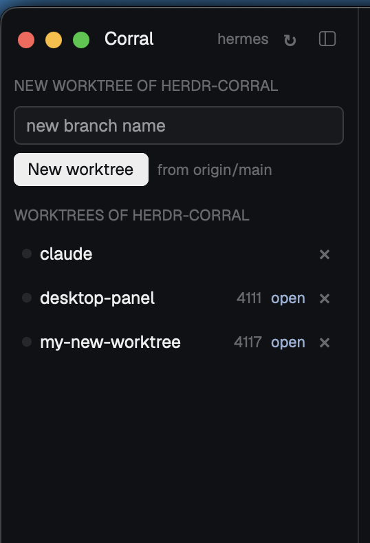

# Corral

A panel for [Corral](https://github.com/bfreed/herdr-corral), the Git-worktree workflow: for the focused space it shows the repository, its worktrees with their ports and dev servers, and buttons to create, open, clean up and delete worktrees. It runs `hwt` on the space's own machine (local or one added under Machines), and when Corral or the repository isn't set up there, it offers to install or set it up.

## What you see

A column docked at the window's left edge, 260 px wide, in the theme's `chrome` color with 10 px padding and 12 px between sections.

- **Header:** "Corral" (13 px, semibold), the space's machine name (11 px, `dim`, "this computer" when local), a ↻ refresh and Herdr's sidebar-toggle icon (`mods/workspace-chrome/sidebar.svg`). On macOS, outside fullscreen, the header is padded past the window buttons.
- **Sections** under 11 px uppercase `dim` titles. Which ones depends on the space:
  - *Install Corral:* the machine has no `hwt`. It says what Install does, or what's missing (git, Python 3.11+).
  - *Update Corral:* the machine's `hwt` is older than the panel needs.
  - *Panel update:* the machine's Corral ships a newer panel than this one.
  - *Set up <repo>:* Corral doesn't know the repository. It shows up to five base branches as radio rows (the remote's default first), with **Set up** and **More settings…** buttons.
  - *New worktree of <repo>:* on a repository's main checkout. A branch-name input, a **New worktree** button, and "from <base branch>".
  - *This worktree:* on a worktree. Its branch with a status dot (`working` color while its dev server listens, `border` otherwise), its dev URL in `accent` (clickable), the dev server state, and **Start dev server** and **Clean up…** buttons.
  - *Worktrees of <repo>:* one 26 px row per linked worktree: dot, branch, port (`dim`), "open" (`accent`) when a space shows it, and a × at the end.
- **Below the sections:** a braille spinner with what's running, and errors in `blocked` with a × to dismiss.
- **Clean up box:** when a Clean up is pending, a bordered (`blocked`) box under the worktree. It explains what's deleted, with **Delete worktree and branch** (red) and **Cancel** buttons. When Corral refuses, the box says why, plus **Delete <branch> anyway** if the refusal is one Corral's `--abandon` would override.
- **Collapsed:** a 40 px rail holding only the toggle icon. On macOS the icon sits 40 px down, below the window buttons.

## How it behaves

- **Following the space:** it follows the focused space, using its first terminal's live folder, and refreshes when that changes or every 15 s. It doesn't refresh while collapsed.
- **New worktree** runs `hwt new <branch> --repo <main checkout> --background` on the space's machine. Then it selects the new space when Desktop shows it, names its tabs agent, shell and server, and orders them that way.
- **Clicking a worktree row** selects the space that shows it, or runs `hwt open <path>`.
- **Cleaning up:** × (or **Clean up…**) asks first. **Delete worktree and branch** runs `hwt cleanup <path>`, which is merge-checked. **Delete anyway** runs `hwt cleanup <path> --abandon --confirm <branch>`.
- **Install** runs on the space's machine: it clones this repository's release tag into `~/.local/share/herdr-corral`, then runs `install.py --desktop --repos-root <the repo's parent folder> --agent-kind claude`.
- **Windows machines:** a space's machine can run Windows whatever this window runs on, so the panel decides per machine. It tries `sh`; when there is none ("cannot start sh: program not found") or it's Git's (`uname` says MINGW/MSYS/CYGWIN), it runs programs directly: the probe and Install as Python scripts (`py -3`, else `python`, else `python3`), `hwt` as `<python> <clone>\hwt.py`, which it reads from the `hwt.cmd` install.py writes (Herdr's exec starts only `.exe` files by name), and `hc` by the path the probe found. It remembers the machine and its Python. Windows paths from Herdr, git and hwt (`C:\…`, either separator, any case) are compared without regard to case or separator.
- **Update panel** copies the machine's `desktop/corral/mods/corral/*` over this panel's own files, with `main.js` last.
- **Tab names:** any terminal labelled `corral.tab=<name>` gets its tab named that, once. A tab the person named is never renamed.

## Built from

One mod, `corral`, placed `"left"` at 260 px. It uses these `herdr` functions:

- `exec` (with `on: space.machine`): as `sh -lc` on POSIX machines, so the login PATH applies; on Windows machines, programs directly
- `spaces`, `panes`, `focused`, `terminals`
- `run`: `tab.rename`, `tab.move`, `space.select`, `tab.new`, `layout.resize`
- `layout`, `window`, `settings`, `theme`, `notify`
- `shared` / `setShared` (`corral.width`)
- `readTextFile` / `writeTextFile` / `appHome` (the self-update)

It runs `hwt` (Corral ≥ 1.2.0; on Windows ≥ 1.3.0), `hc ls`/`hc send` (Start dev server), `git`, `python3` (on Windows `py`/`python`) and `open`/`xdg-open`/`start`. It reaches the network only through Install (`git clone`).

## Watch out

- **The panel only shows what `hwt` knows.** `hwt --frontend desktop info <folder>` is its single source of truth.
- **Tab names come from the panel.** herdr-core can't name tabs, so Corral labels terminals and the panel names the tabs. Without the panel, Corral's tabs show as 1, 2, 3.
- **Remote tab ids carry a `machine/` prefix**, which terminal labels don't. Compare the last path segment.
- **Older `hwt` releases don't know `--frontend`:** run `hwt update` without it.
- **Docked left, it's the window's first column**, under macOS's window buttons.
- **Herdr won't dock it into a shipped layout.** `main` (the default), `terminals` and `win98` are read-only; while one shows, a new mod waits, with no error. The installers (`desktop/install.sh`, `desktop/install.ps1`) ask the open window for a copy first: `herdr-app do layout.clone --name main --as main-corral`, which switches to it, and Herdr docks the panel there. By hand: add `{"id":"corral","type":"block","size":{"px":260},"content":{"mod":"corral"}}` as the first child of your own layout's root row.
- **Collapse goes by width:** the panel finds its own layout block by `content.mod === "corral"` and resizes it.

## Done when

- **Main checkout:** on a repository's main checkout, New worktree makes a space with agent, shell and server tabs in that order, and selects it.
- **Clean up:** × then **Delete worktree and branch** removes a merged worktree and its branch. An unmerged one shows Corral's reason and **Delete <branch> anyway**.
- **Install:** a space on a machine without Corral shows Install. After it, the same space shows **Set up** or the repository. The same on a Windows machine.
- **Docked:** after `install.sh`/`install.ps1` on a fresh Herdr (showing `main`), the panel shows on the left of `main-corral`.
- **Collapse:** the toggle folds the panel to a 40 px rail and back to its width.
- **Checker:** `herdr-app check` passes.
